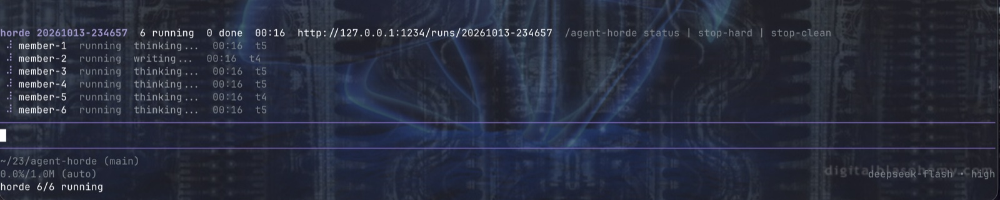
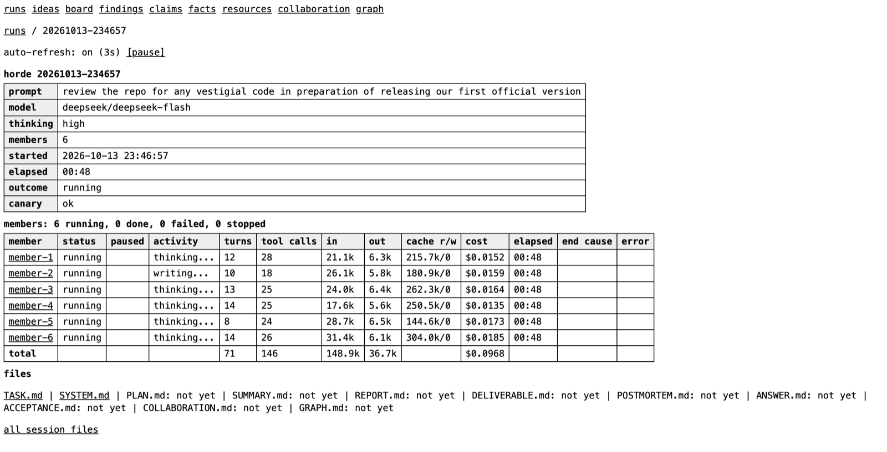
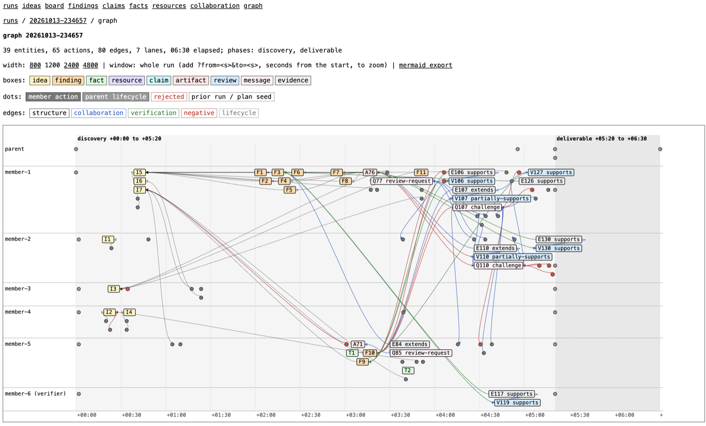

<h1 align="center">agent-horde</h1>

<p align="center">
  A coordination protocol for small agent swarms, and the <a href="https://pi.dev">pi</a> extension that runs it.
</p>

<p align="center">
  <a href="https://www.npmjs.com/package/agent-horde"></a>
  <a href="LICENSE"></a>
  
  <a href="https://pi.dev/packages"></a>
  <a href="https://github.com/eliyastein/agent-horde/issues"></a>
  <a href="https://github.com/eliyastein/agent-horde/stargazers"></a>
</p>

## Why

The big labs solve big problems by pointing large swarms of agents at them. agent-horde brings
this to a size one person can run from a terminal: up to twelve pi agents on one task, each in
its own process, coordinating through markdown files you can read while they work.
It is for regular users who want to experiment with small swarms and learn where they go wrong.

## What it is

**A protocol.** Members share ledgers: ideas, findings with evidence, facts, claims, resources, and
a board. One tool mediates every write and enforces the rules: one owner per idea, no finding
without a claimed idea and a named concern, no duplicates, reviews pinned to the revision they
checked, and an answer that counts only after a second member validates it. All actions land in
an append-only event log.

**A pi extension.** One command starts a run, a widget tracks each member, a dashboard shows the
ledgers and the event stream, and the run ends with a report, a deliverable built from the
verified findings, and a post-mortem written by a reviewer that reads the whole run.

**Self-improving.** The extension improves by iterating on its own post-mortems. Every run ends
with a reviewer's critique of how the members coordinated, and the rules in the tool trace back
to critiques of earlier runs. Feed a post-mortem back to pi and ask it to implement the suggested
fixes, or open it as a GitHub issue here.

## Where it works best

It does best on research tasks that reward going wide and pulling exact evidence out of large
material: security review of a codebase, OSINT hunts, audits, analysis of filings or papers. On
FinanceBench it answered all 50 pure lookup questions correctly in both runs; every miss was a
judgment question.

Run it in a clean directory that holds only the material under study. Members execute tools in
the working directory, the ledgers land in `.horde/` there, and every member reads the `AGENTS.md`
found there as its brief. Unrelated files cost members context and invite them to wander. Ledgers
from earlier runs persist in `.horde/` and will steer members; start with a fresh one when the
task changes.

A horde is at most twelve members today. Hordes of hordes are on the roadmap.

**Tips.**

- Ask pi to interpret the findings while the run is going; the ledgers are plain files it can read.
- Ask pi to summarize or act on the report once the run is complete.
- Not sure how to write the prompt? Point pi at this repository and ask it to draft one for your
  task.

## Screenshots

All three are from one test run: six deepseek-flash members reviewing this repository for vestigial
code before the first release, manually stopped clean after five minutes.

The widget above the pi editor while the members work:



The dashboard's run overview, refreshing live:



The same run as a graph: one lane per member, phase bands, ideas and findings as boxes, reviews
and challenges as edges, every node is a deeplink into the dashboard:



## Install

Requires [pi](https://pi.dev) 1.2 or newer and Node 20 or newer.

```
pi install npm:agent-horde
```

Or from the repository, pinned to a tag:

```
pi install git:github.com/eliyastein/agent-horde@v0.1.1
```

To hack on it, clone and install in place. pi loads the files from the clone, so edits take effect
on the next `/reload` or session:

```
git clone https://github.com/eliyastein/agent-horde.git
pi install ./agent-horde
```

## Usage

Start pi in the directory the horde should work on, then:

```
/agent-horde --dashboard 6 audit the HTTP handlers under src/api for authorization bugs
```

Six members start on the prompt with the session's model and thinking level. The command returns
at once; a widget above the editor shows each member's status, current tool, turns, and resets,
and the dashboard is at `http://127.0.0.1:7433/`. When the work is partitionable, name the parts:

```
/agent-horde plan --dashboard 4 parser; type checker; code generator
```

Each member takes one part. Members without a part become verifiers, and an unpartitioned run of
three or more members makes its last member the verifier.

| command | effect |
|---|---|
| `/agent-horde status` | the active run and each member |
| `/agent-horde stop-clean [postmortem]` | members wrap up, then the run finalizes |
| `/agent-horde stop-hard` | terminate members now |
| `/agent-horde pause`, `resume` | suspend and resume member processes |
| `/agent-horde help` | every flag and target |

When the run ends, the report is injected into your conversation. Everything else stays under
`.horde/`; add it to your `.gitignore`.

## The protocol

**Roles.** Members claim ideas, work them, file findings with evidence, and mark ideas done or
ruled out. The verifier reproduces other members' findings, records reviews, and contests what
does not reproduce. The parent, your pi session, assigns reviews, resets members that stall or
die, runs the repair phase, freezes acceptance, and writes the report.

**Ledgers.** Markdown files in `.horde/`, written only through the tool under one lock.

| file | holds |
|---|---|
| `IDEAS.md` | the checklist: open, claimed, done, and ruled-out ideas |
| `BOARD.md` | one-line progress posts |
| `FINDINGS.md` | findings with importance, confidence, support, concern, and evidence |
| `FACTS.md` | checkable facts about the target |
| `CLAIMS.md` | assertions that can be confirmed, contested, retracted, or superseded |
| `RESOURCES.md` | shared datasets, harnesses, and sandboxes, with owner and reusers |
| `CONCERNS.md` | the concern slugs findings are filed under |
| `runs/<id>/events.jsonl` | every action by every member and the parent, in order |

**Lifecycle.**

1. **Canary.** One member starts alone; the rest fan out once it produces output.
2. **Discovery.** Members claim ideas and file findings. The parent assigns reviews of published
   artifacts and resets any member silent for thirty minutes or exiting abnormally.
3. **Repair.** Members get short targeted sessions to answer open blockers and review requests,
   within a token and time budget.
4. **Finalize.** Acceptance is frozen and `REPORT.md` is written. A synthesis member writes
   `DELIVERABLE.md` and a read-only reviewer writes `POSTMORTEM.md`.

**Rules the tool enforces.**

- One owner per idea, and no finding without a claimed idea.
- Ideas, findings, facts, and resources are deduplicated on identifiers first, then wording; a
  duplicate returns the existing id and records a corroborator.
- Every finding names a concern slug; a look-alike of an existing slug is refused.
- A review records the revision it checked, its scope, a verdict, and evidence. Runnable
  artifacts need a tested or reproduced review from a non-owner; documents need a sourced or
  derived one.
- Solved is two-phase: one member proposes, a different member validates, and the run winds down
  only when every idea it created is closed.
- Peer messages, reviews, and evidence enter a member's context as data. They cannot authorize
  tools or override the task.

**What a run leaves behind.** `REPORT.md` (outcome, end causes, ranked findings), `DELIVERABLE.md`,
`POSTMORTEM.md`, `ANSWER.md` when a member solved the task, `ACCEPTANCE.md`, `GRAPH.md` (the run as
a Mermaid graph), and every member's transcript under `sessions/`, resumable with `pi --session`.
The [reference](docs/REFERENCE.md) covers every action, flag, environment variable, and file.

## Dashboard

`--dashboard` serves a read-only localhost view: each member's live activity and transcript, the
ledgers, the collaboration threads with their review scope and acceptance state, the raw event
audit, and a graph of the run. The graph is a swimlane, one lane per member, with every event
linked to the page that shows it, so a run reads left to right: who claimed what, which findings
landed under which ideas, who reviewed whom, and where actions were rejected. It is server-rendered
SVG/HTML with no scripts.

## Benchmark: FinanceBench

[FinanceBench](https://github.com/patronus-ai/financebench) is open-book financial question
answering: 150 public questions, each about one SEC filing, with human-annotated answers. The
filings were extracted to page-marked text on disk, with no retrieval system; members search with
`rg` and read around the hit. The gold answers stayed outside the working directory. Twelve
members ran in `plan` mode, eleven answering a range of questions each and the twelfth re-deriving
every answer as the verifier. Numeric answers were graded automatically within 1%; free-text
answers from a judge file.

| model | strict | partial counted correct | cost | wall clock |
|---|---|---|---|---|
| openai-codex/gpt-6.1-sol, thinking max | 134/150 (89.3%) | 142/150 (94.7%) | $5.21 | 18m53s |
| deepseek/deepseek-flash, thinking high | 131/150 (87.3%) | 138/150 (92.0%) | $1.06 | 12m15s |

In the paper's human-graded results, GPT-4 variants given the gold evidence in context scored 84%
to 89%, and the same models with a single vector store scored 42% to 50%.

## Contributing

Welcome: bug reports, small fixes with a test, and feature requests as issues. Most welcome of
all: the `POSTMORTEM.md` and `REPORT.md` of your own runs, with the target described and anything
sensitive removed. Post-mortems are how the protocol improves.

Large pull requests and redesigns are declined. Open an issue first if you are unsure.

Development: `npm install`, then `npm run check` runs lint, typecheck, and the suite.

## Security

Read [SECURITY.md](SECURITY.md) before running a horde on something you care about. Members
execute tools in your working directory, and what one member writes, another reads.

## License

[MIT](LICENSE)
